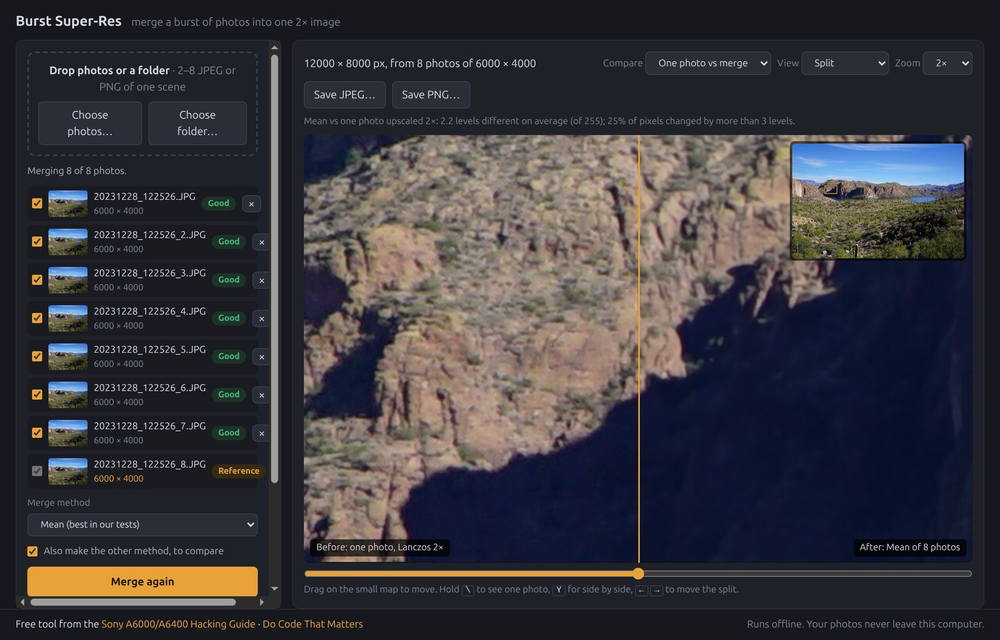
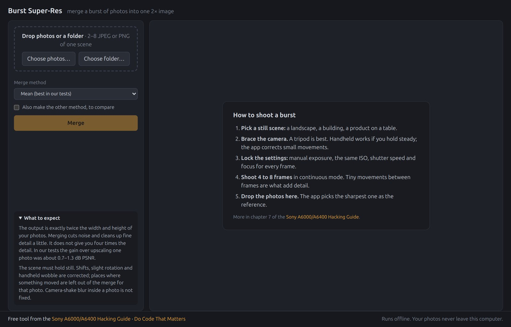
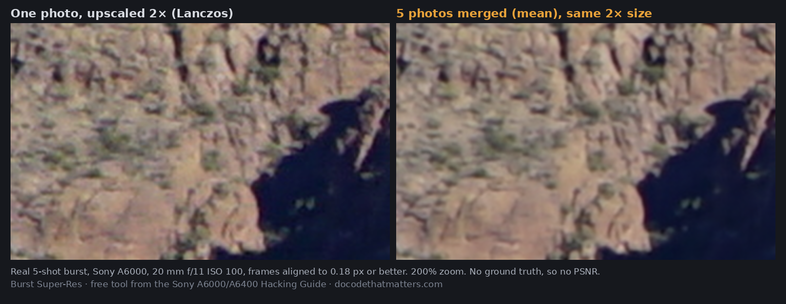
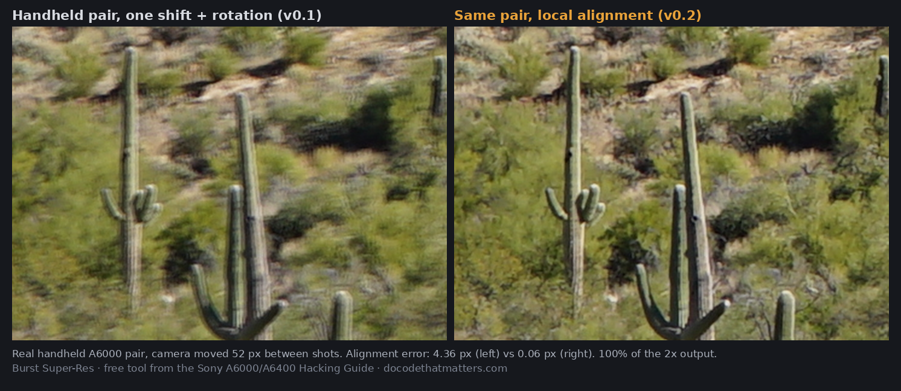
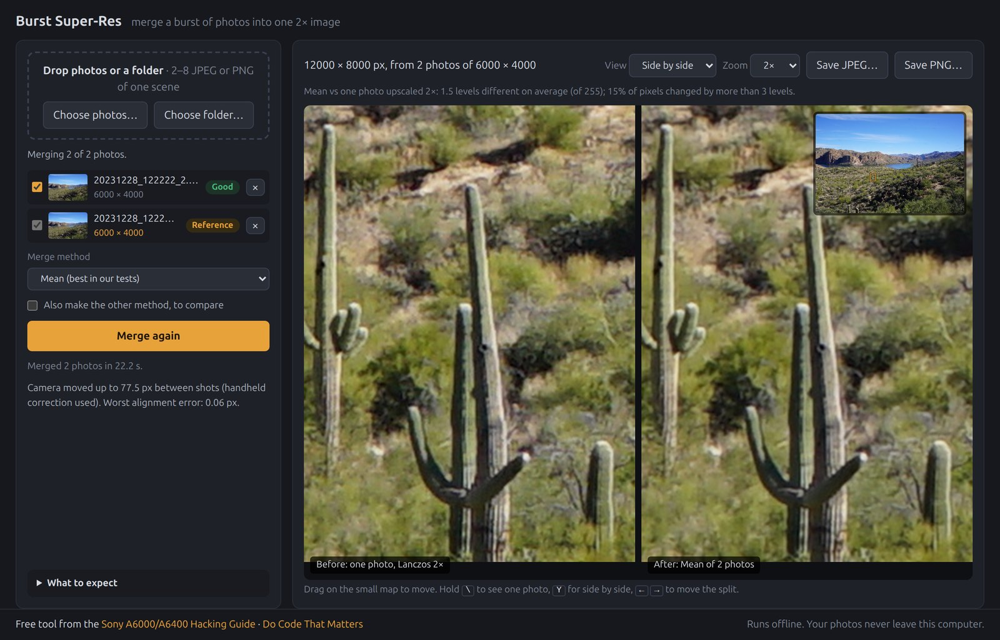
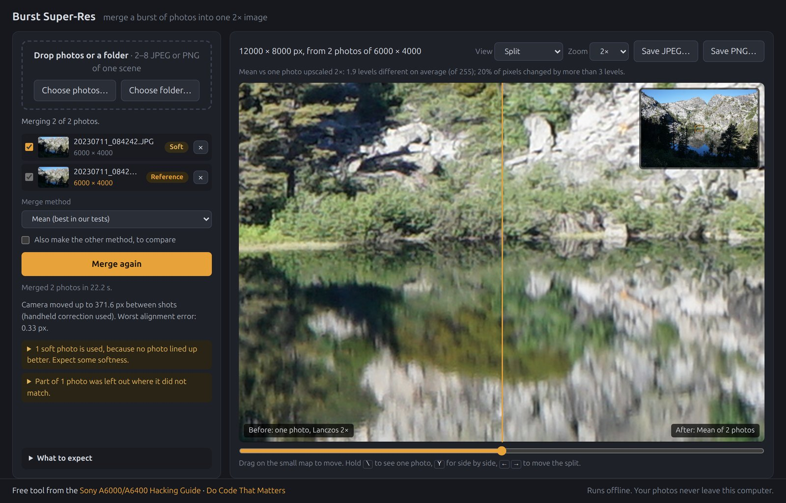
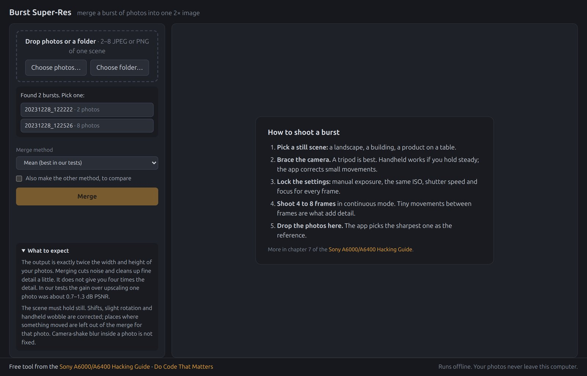
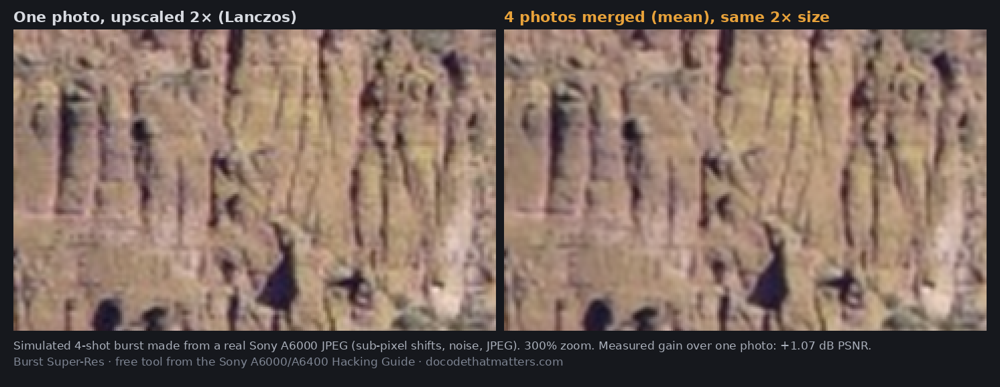

# Burst Super-Res

**Merge a burst of photos of the same scene into one image with twice the width and height.** A small, free desktop app for macOS, Windows and Linux, from the [Sony A6000/A6400 Hacking Guide](https://dctmlab.taila665d5.ts.net/) by [Do Code That Matters](https://docodethatmatters.com/).



*A real 8-shot A6000 burst of a canyon, dropped in as a folder. Every shot aligned to 0.22 px or better (5 of them with the handheld correction). Left of the slider: one photo upscaled 2x. Right: the mean of all 8.*

- **Drop in photos or a whole folder.** JPEG or PNG, straight from the camera. A folder with several bursts gets a chooser.
- **Sub-pixel alignment, handheld too.** Shifts and slight rotation are corrected for the whole photo. When that is not enough (handheld parallax, lens distortion), a local correction aligns each 64 px area on its own.
- **Bad photos are left out for you.** Each photo gets a badge: Good, Soft or Too far off. Photos that do not line up are unticked automatically; areas where something moved are left out of that photo.
- **Exactly 2x per side.** Four 6000 x 4000 photos give one 12000 x 8000 image. The app shows real pixel dimensions, not a megapixel claim.
- **Compare like a photo editor.** Split slider or side by side, a small map to move around, Mean vs Median, and Lightroom-style keys.
- **Keeps your EXIF.** Camera, lens, date and exposure from the reference photo go into the saved JPEG.
- **Private and offline.** Your photos never leave your computer. No account, no upload, no nag screen.

## Download

Get the latest version from [Releases](https://github.com/skittleson/burst-superres/releases/latest):

| Your computer | File |
|---|---|
| macOS 15 or newer (Apple Silicon and Intel) | `burst-superres-*-macos-universal.zip` |
| Windows 10 or 11 (x64) | `burst-superres-*-windows-x86_64.zip` |
| Linux x86_64 (Ubuntu 22.04, Debian 12 or newer) | `burst-superres-*-linux-x86_64.AppImage` or `.tar.gz` |
| Linux ARM64 | `burst-superres-*-linux-arm64.AppImage` or `.tar.gz` |

The builds are not signed. On macOS, right-click the app and pick **Open** the first time (or **System Settings > Privacy & Security > Open Anyway**). On Windows, click **More info > Run anyway** if SmartScreen warns you. On Linux, install `libwebkit2gtk-4.1-0` first, then `chmod +x` the AppImage and run it (it adds itself to your app menu on first run). The AppImage does not bundle WebKitGTK.

## How to use it



1. Shoot a burst of a still scene: 4 to 8 frames, the same settings for every frame. A tripod is best; a braced handheld burst works too.
2. Drop the photos or the folder into the window, or click **Choose photos...** / **Choose folder...**.
3. Click **Merge**. The app picks the sharpest photo as the reference, aligns the others, unticks any that do not line up, and merges.
4. Drag on the small map to pick a spot. Drag the slider, or use the keys below.
5. Click **Save JPEG...** or **Save PNG...**.

| Key | Does |
|---|---|
| hold `\` | show the single photo (release to go back) |
| `Y` | split view / side by side |
| `←` `→` | move the split (`Shift` for small steps) |

Changing the ticked photos or the method shows **Settings changed since this merge**. **Merge again** reuses the aligned photos, so it skips reading and aligning. **Cancel** stops a merge at any time.

## Examples

### A real steady burst: it works

The screenshot at the top. All 8 frames of a 13-shot burst (A6000, 20 mm, f/11, ISO 100). Version 0.1 could only use 5 of them; the handheld correction brought the other 3 from 0.33-0.62 px down to 0.05-0.22 px. At 200% zoom the merge has less noise and fewer JPEG block edges than one photo upscaled:



A real burst has no "true" high-resolution image, so there is no PSNR for this example.

### A handheld pair: now it works

Two handheld shots. The camera moved 52 px and turned 0.11 degrees, and the near cactus and the far hills moved by different amounts (parallax). One shift-plus-rotation for the whole photo leaves 4.36 px of error and a doubled cactus. The local correction brings it to 0.06 px:





### A burst that moved too much: the app says so

These two shots were taken 4 s apart, handheld; the camera moved about 370 px. The local correction gets to 0.33 px, which is "Soft", and part of the photo did not match at all (the lake surface moves). The app uses the photo because no better one exists, and says so:



### A folder with several bursts

Drop a folder, and the app groups the photos into bursts by name (`..._122526.JPG`, `..._122526_2.JPG`) or, for camera names like `DSC01234.JPG`, by EXIF capture time (2 s or less apart). Pick one:



### A simulated burst with a known answer: +1.07 dB

To measure the gain, I made a 4-shot burst from one real A6000 photo (sub-pixel shifts, sensor-style 2x downsampling, noise, JPEG) and merged it back to full size. Against the original photo, the merge scored +1.07 dB PSNR over one photo upscaled 2x. On the A6400 test photo the gain was +1.25 dB. All runs are in [Measured results](#measured-results).



## What the numbers in the app mean

- **Badges.** Each photo's alignment error after correction: **Good** is 0.3 px or less, **Soft** is up to 1 px, **Too far off** is more. Hover a badge for the numbers: how far the photo moved and turned, its alignment error, whether the handheld correction was used, and how much of it was left out.
- **Merging N of M photos.** Photos above 0.3 px are unticked automatically. Tick them to use them anyway. If only the reference is Good, Soft photos are used and the app tells you.
- **Camera moved up to X px between shots.** The largest movement of any corner or the centre, compared to the reference. Some movement is good: the small sub-pixel offsets between shots are what add detail. If nothing moved, the app tells you that merging only reduces noise.
- **Worst alignment error.** The largest remaining error of any photo, after the shift, rotation and handheld correction.
- **Part of a photo was left out.** Areas of 64 px where a photo still did not match (more than 1 px off, or a much larger brightness difference than elsewhere). The merge uses the other photos there. This is how moving leaves, water or people are kept from ghosting.
- **Mean vs one photo upscaled 2x.** The mean luma difference between the merge and the sharpest photo upscaled 2x on its own, and the percentage of pixels that changed by more than 3 levels (of 255). It samples 96 rows, so it adds little time.
- **Time estimate.** Before a merge, from your last merge on this computer. During a merge, from the progress so far.

The output is exactly 2x per side, and the app shows the real pixel dimensions. It does not claim a megapixel number, because the extra pixels do not hold 4x the detail.

Everything runs on your computer. The app makes no network requests except when you click a link to the guide.

## What it does not do

- **It needs a still scene.** Landscapes, architecture and product shots work. Areas where something moved are left out of that photo, so moving leaves or water do not ghost, but they do not gain detail either.
- **Big handheld movements end up soft.** The correction works best when the camera moved a little. In my 4-second handheld pair (370 px of movement) the result was 0.33 px, "Soft".
- **It does not remove camera shake blur.** A blurry photo stays blurry.
- **It needs a small movement between shots.** If the photos are pixel-identical in position, merging only reduces noise. The app tells you when this happens.
- **The gain is modest.** Expect less noise and cleaner fine edges. Do not expect 4x the detail. See the numbers below.
- RAW files are not supported. Export JPEG or PNG first.
- EXIF is copied to JPEG output only, not PNG.

## Measured results

### Method

I have no real tripod burst with a known "true" high-resolution image. So I made simulated bursts from real camera JPEGs and measured against the original:

1. Take a real 24 MP JPEG as the ground truth: the ILCE-6400 test photo, and a detailed A6000 landscape (`20231228_122222.JPG` from my `dslrCameraPowerRename` samples).
2. Make N frames. Frame 0 is the original. Every other frame gets a random shift of up to 1.5 px (at frame resolution), and optionally a random rotation of up to 0.5 degrees.
3. Downsample every frame 2x with a 2x2 box filter. This models how a sensor pixel integrates light.
4. Add Gaussian noise (sigma 2 levels) and save as JPEG quality 92 with libjpeg-turbo.
5. Merge the frames back to the original size with every method. Measure luma PSNR and SSIM against the original. A 16 px border is excluded.

The baseline is the reference frame alone, upscaled 2x with the same Lanczos-3 resampler. That is the honest comparison: the same output size, with and without the burst.

Run it yourself: `npm run bench -- --gt your-photo.jpg --seed 2` (see `tools/bench.js`). The raw numbers are in `docs/results/`.

### Numbers

PSNR in dB / SSIM, whole image. "Gain" is mean minus single photo.

| Run | Ground truth | Frames | Noise | Max rotation | Worst alignment error | Single photo 2x | Mean | Median | Pairwise 50% | Gain (mean) | Mean time |
|---|---|---|---|---|---|---|---|---|---|---|---|
| a6400-s2-noise2 | A6400 test photo | 4 | 2 | 0 | 0.015 px | 38.59 / 0.8941 | **39.84 / 0.9164** | 39.73 / 0.9144 | 39.82 / 0.9159 | **+1.25** | 3.9 s |
| a6400-s2-noise0 | A6400 test photo | 4 | 0 | 0 | 0.014 px | 39.09 / 0.9018 | **39.77 / 0.9139** | 39.69 / 0.9123 | 39.76 / 0.9136 | **+0.69** | 4.1 s |
| a6400-s3-rot0.5 | A6400 test photo | 4 | 2 | 0.5 deg | 0.015 px | 38.60 / 0.8942 | **39.88 / 0.9171** | 39.76 / 0.9150 | 39.86 / 0.9166 | **+1.28** | 5.2 s |
| a6000land-s2-noise2 | A6000 landscape | 4 | 2 | 0 | 0.014 px | 33.51 / 0.9274 | **34.58 / 0.9459** | 34.47 / 0.9445 | 34.57 / 0.9456 | **+1.07** | 4.7 s |
| a6000land-s2-noise0 | A6000 landscape | 4 | 0 | 0 | 0.014 px | 33.68 / 0.9335 | **34.61 / 0.9467** | 34.51 / 0.9455 | 34.60 / 0.9464 | **+0.93** | 5.2 s |
| a6000land-s3-rot0.5 | A6000 landscape | 4 | 2 | 0.5 deg | 0.029 px | 33.51 / 0.9274 | **34.55 / 0.9459** | 34.44 / 0.9444 | 34.54 / 0.9455 | **+1.04** | 5.5 s |
| a6000land-s4-8frames | A6000 landscape | 8 | 2 | 0 | 0.020 px | 33.51 / 0.9274 | **34.80 / 0.9495** | 34.63 / 0.9475 | 34.79 / 0.9491 | **+1.30** | 10.6 s |

Times are node 25 (V8) on this machine (24 threads), with 3000 x 1688 or 3000 x 2000 inputs.

What the numbers say:

- The gain over one upscaled photo is **+0.7 to +1.3 dB**. That is real but modest.
- Without added noise the gain is still +0.7 to +0.9 dB. So part of the gain is real detail (less aliasing), not only noise reduction.
- 8 frames are a little better than 4 (+1.30 vs +1.07 dB on the same scene).
- Alignment error stayed at or below 0.03 px in every run, including the rotated bursts.
- Mean is the best method in every run, so it is the default. Median is 0.1 dB lower but resists moving objects. Pairwise is 0.01 to 0.02 dB lower than mean.

These are simulated bursts. A real camera adds demosaicing, an anti-aliasing filter and lens blur. I expect the gain on real tripod bursts to be the same or smaller. I did not measure it, because I do not have a tripod burst with a ground truth.

### Handheld bursts and local alignment (v0.2)

Version 0.1 aligned each photo with one shift plus rotation (affine). On my two real handheld pairs that left 4.4 px and 21.9 px of error, from parallax between near bushes and far hills. A perspective fit was not enough either (0.6 px and 6.3 px). Version 0.2 adds a local correction: a grid of 64 px cells measured on top of the affine warp, smoothed, refined three times, then measured once more for the reported error.

To measure it against a known answer, the benchmark's `--wobble 3` bends every simulated frame by a smooth displacement of up to 3 px (half that at frame resolution), different for each frame:

| Run | Single photo 2x | Mean, affine only | Mean, with local alignment | Estimated error |
|---|---|---|---|---|
| a6000land-s5-wobble3 | 33.51 dB | 29.11 dB | **34.52 dB (+1.01)** | 0.06-0.08 px |
| a6400-s5-wobble3 | 38.60 dB | 38.17 dB | **39.58 dB (+0.98)** | 0.07-0.09 px |

The tripod-style runs are unchanged, because the local correction only runs when the affine fit is worse than 0.1 px (a6400-s2-noise2: 39.843 dB before and after; a6000land-s3-rot0.5: 34.551 dB before and after).

On a synthetic test with a known displacement field, the true remaining error with 64 px cells was 0.031 px (1 px wobble), 0.086 px (3 px) and 0.171 px (6 px). With 128 px cells it was 0.14, 0.42 and 0.84 px.

Real photos, as measured by the app:

| Burst | Affine only | With local alignment | Badge |
|---|---|---|---|
| Handheld pair `20231228_122222` (moved 52 px) | 4.36 px | 0.06 px, 2% left out | Good |
| Handheld pair `20230711_084242` (4 s apart, moved ~370 px) | 19.16 px | 0.33 px, 28% left out | Soft |
| Steady burst `20231228_122526`, frames 1-3 | 0.33-0.62 px | 0.05-0.22 px | Good |

Local alignment costs time: about 7 to 13 s per 24 MP photo that needs it (node, this machine).

### How I found the steady burst

I found the real burst in my Immich library. I searched for bursts: 732 groups of 3 or more Sony shots taken 3 s or less apart with identical settings. I ran the app's alignment on the first 4 frames of 348 groups (ISO 400 or lower, 4 or more shots). 302 of them were handheld, with more than 10 px of alignment error. One burst was steady: `20231228_122526.JPG` to `_13`. With version 0.1, frames `_4` to `_8` aligned to 0.18 px or better and frames 1 to 3 (moved up to 12.8 px) only to 0.33 to 0.62 px. With version 0.2 all 8 align to 0.22 px or better.

### A method that did not help: shift-and-add

I also tried true shift-and-add: put every input pixel at its exact sub-pixel position on the 2x grid with a small Gaussian kernel, then normalize. On test patterns with strong aliasing it beat the mean by 1.0 to 1.7 dB. On the real photos it was equal to the mean on the whole image. On the detailed landscape crop it was 0.2 dB worse with 4 frames and 0.5 dB worse with 8 frames. I removed it from the app. The numbers are in `docs/results/v1-translation-only/`, from an earlier translation-only build.

## How it works

The math is in `src/frontend/sr-core.js`, with no dependencies. `exif.js` copies EXIF, `bursts.js` groups a folder into bursts.

**Registration.**
1. Convert each photo to luma and build an image pyramid (2x2 box downsampling). The finest level gets a light Gaussian blur (sigma 1). This reduces aliasing and the bias that bilinear interpolation gives Lucas-Kanade towards whole pixels.
2. Find the global shift: exhaustive integer search at the coarsest level, then inverse-compositional Lucas-Kanade (translation) at each finer level.
3. Measure a grid of up to 8 x 6 tiles (512 px) inside the overlap. Each tile gets its own coarse-to-fine sub-pixel shift. The tile position is the gradient-energy centroid, not the tile centre, because that is where the shift is measured under rotation.
4. Fit an affine warp through the tile vectors with least squares. Remove featureless tiles (sky) and tiles that disagree (moving objects).
5. Repeat steps 3 and 4 twice more. Each time, pre-warp the frame tiles with the current fit, so the rotation inside a tile does not bias the shift. On a 1 degree test rotation this pass took the worst error from 0.040 px to 0.014 px.

6. **Local correction (handheld).** If the affine fit is worse than 0.1 px, measure a grid of 64 px cells on top of the affine warp, without a coarse search. Fill featureless cells from their neighbours, median-filter the field, and add it. Repeat three times, then measure once more: that is the reported alignment error. Cells still more than 1 px off (or with a much larger brightness difference than the rest) are marked, and the merge leaves that photo out there.

**Merge.** For each output strip, render every photo through its warp onto the 2x grid with Lanczos-3. With a local correction, each 128-pixel column block uses the affine warp that matches the field at its centre. The affine resampling uses two separable passes (Catmull-Smith), so it is exact for affine warps and costs 12 taps per pixel, not 36. Then take the per-pixel mean (or median) of the photos that cover the pixel. Mean and median can come from the same pass, for the comparison.

**Why the guide's pairwise blend is an option, not the default.** The guide upscales two photos, aligns them, blends them 50/50, and repeats in pairs. For 4 photos that is a mean, with rounding to 8 bits after each stage. For 3 photos it weights them 25/25/50, which is worse. The mean does the same work with exact weights for any count. The pairwise mode stays in the app so you can compare against the original method. It rounds half to even, like OpenCV.

**Reference frame.** The sharpest photo (highest variance of the Laplacian) is the reference, as in `image_utils.py`.

## Where the pixel work runs, and why

tinyjs apps have two halves: a txiki.js backend (QuickJS, no JIT) and the OS webview (WebKitGTK, WKWebView or WebView2, all with a JIT). So:

- **All pixel work runs in the page, in a Web Worker.** A tight numeric loop is much faster in a JIT, and the worker keeps the window responsive. The worker is built from function source as a Blob URL, because Chromium, which WebView2 uses, blocks workers loaded from `file://` URLs by default.
- **The backend only writes the output file.** The page encodes the result with `canvas.toBlob()` and sends it to the backend in 3 MB base64 chunks, because the bridge is text. A spike measured 16 MB in 1.3 s.
- **Inputs load in the page** with `tiny.fileURL(path)` (`readAccess: true` in `tinyjs.json`). The webview decodes the JPEG and applies EXIF orientation.
- **Memory.** Photos stay as 8-bit RGBA (96 MB per 24 MP photo). The merge works in strips of 32 output rows, so it never allocates a full-size float buffer. The output is one RGBA buffer (384 MB at 12000 x 8000). Measured peak for 2 x 24 MP photos: 1.9 GB in the WebKit web process. Plan for 2 to 3 GB of free RAM for 4 x 24 MP. The limit is about 67 MP inputs, because the 2x result must fit in one canvas (268 million pixels).

Measured in the app on this Linux machine (WebKitGTK 2.52):

| Input | Output | Merge time | Save JPEG |
|---|---|---|---|
| 4 x 3000 x 2000 | 6000 x 4000 | 6.9 s | 0.7 s |
| 4 x 6000 x 4000 (24 MP) | 12000 x 8000 | 31.3 s | 2.5 s |
| 2 x 6000 x 4000, real handheld pair, v0.1 (affine only) | 12000 x 8000 | 18.6 s | 2.3 s |
| 2 x 6000 x 4000, real handheld pair, v0.2 (local correction) | 12000 x 8000 | 31.4 s | 2.5 s |
| 5 x 6000 x 4000, real steady burst, v0.1 | 12000 x 8000 | 36.9 s | not measured |
| 8 x 6000 x 4000, real burst, v0.2 (5 local corrections) | 12000 x 8000 | 138.3 s | not measured |

The app output and the node output agree to 50.6 dB PSNR. The difference is the JPEG quality 95 encoding of the saved file.

## Build and run

You need the tinyjs CLI (0.51.1 or newer; releases use 0.70.3): https://tinyjs.app/

```sh
tinyjs dev      # run with hot reload
tinyjs build    # build dist/burst-superres for this OS
```

The app has no runtime dependencies. Node is only for the tests and the benchmark:

```sh
npm install     # dev tools only: pngjs for the benchmark crops
npm test        # unit tests for alignment and merge math (node --test)
npm run bench -- --gt test_photo.jpg --seed 2               # e.g. the A6400 test photo
npm run bench -- --gt path/to/photo.jpg --crop 400,1400,800,500 --rot 0.5
```

The benchmark needs `djpeg` and `cjpeg` (libjpeg-turbo) on the PATH. I do not use jpeg-js, because its decoder truncates instead of rounding. That shifts every pixel by -0.53 levels per round trip and skews PSNR.

`tools/before-after.py` (needs Pillow) makes the labelled comparison image from a benchmark run, or from two crops with `--before` and `--after`.

`tools/ui-preview/serve.js` serves the real frontend to a normal browser, with a stand-in for the tinyjs bridge, for docs screenshots. The screenshots in this README come from it, rendered in headless Chromium at 1280 x 820 (2x). They show the same HTML, CSS and JavaScript as the app, without the native window frame. The URL hash takes the same JSON as `BURST_SELFTEST`.

### End-to-end smoke test

The app has a self-test that drives the real UI in the real webview. It is off unless you set `BURST_SELFTEST`:

```sh
BURST_SELFTEST='{"photos":["/abs/a.jpg","/abs/b.jpg"],"mode":"mean","out":"/tmp/merged.jpg","focus":[2000,1500]}' tinyjs dev
```

It adds the photos, merges, renders the compare view, saves, writes a report to the app store (`~/.local/share/com.docodethatmatters.burstsuperres/store.json` on Linux) and quits. Other keys: `"drop":["/folder"]` with `"pickBurst":1` (folder drop and the burst chooser), `"compare":true` (Mean and Median), `"untick":[0]` (untick, check the stale banner, merge again), `"layout":"side"`, `"compareSel":"methods"`, `"stopAfterAdd":true`, and `"fullscreen":true,"holdMs":8000,"quit":false` to keep the window up for a screenshot.

## Platform status

| Platform | Status |
|---|---|
| Linux x86_64 (Pop!_OS 24.04, WebKitGTK 2.52, Wayland) | Tested end to end: `tinyjs dev`, `tinyjs build`, and the built binary with the smoke test, on tinyjs 0.51.1 and 0.70.3. The binaries need glibc 2.35 or newer (Ubuntu 22.04 and later). |
| Linux AppImage x86_64 | Built from the release tarball with `packaging/appimage/make-appimage.sh`. Tested: launch, merge, save, and the app-menu entry points at the `.AppImage` file. |
| Linux ARM64 (tarball and AppImage) | Built by GitHub Actions on Ubuntu 22.04. **Not tested.** |
| macOS 15+ (universal) | Built by GitHub Actions (`tinyjs publish --universal`). Ad-hoc signed, not notarized. **Not tested.** |
| Windows 10/11 x64 | Built by GitHub Actions (`tinyjs.cmd publish`). Not code-signed. **Not tested.** Check the Blob-URL worker and saving in WebView2 first. |

Releases come from `.github/workflows/release.yml`. Push a tag like `v0.2.0` to build every platform (plus Linux AppImages) and publish them with checksums.

The code uses no platform-only APIs. `Uint8Array.prototype.toBase64` has a fallback for older webviews.

## What is left

- Test on macOS and Windows.
- Shoot a real tripod burst on an A6400. The real bursts above are from the A6000.
- Speed: alignment and merge are single-threaded JS. Several workers (one per photo or strip range) or WebGL would make them faster; local correction is the slow part.
- EXIF for PNG output, and RAW input.

## Credit

The method and the original Python/OpenCV code come from chapter 7 of the Sony A6000/A6400 Hacking Guide and `image_utils.py` in [dslrCameraPowerRename](https://github.com/skittleson/dslrCameraPowerRename).
